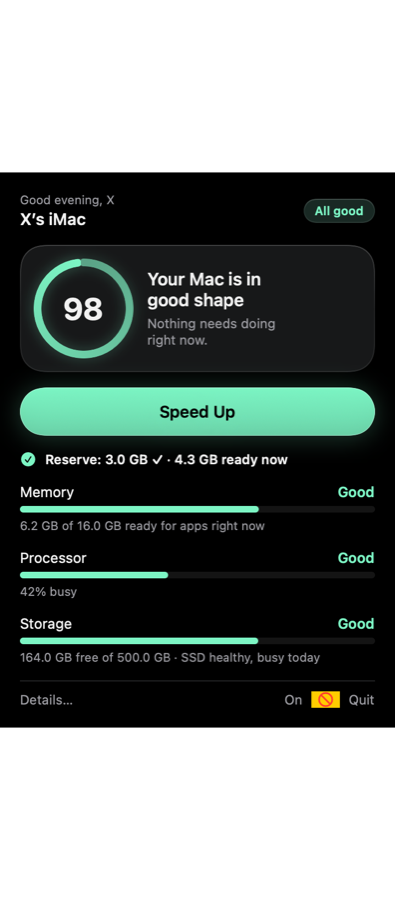
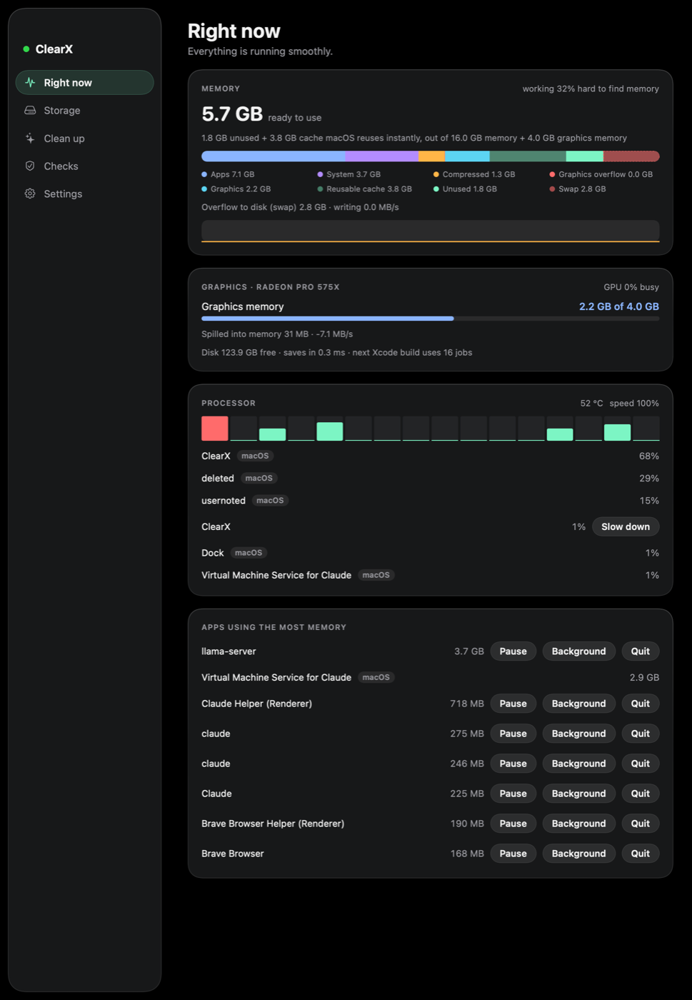

<p align="center"></p>

# ClearX

[](https://github.com/MilGenX/ClearX/actions/workflows/test.yml)


**ClearX is an open-source memory and performance manager for macOS.** When your Mac runs short of memory, gets hot
or its disk slows down, ClearX decides which work can wait, so the app you're using stays responsive. When your Mac
is fine, it does nothing at all.

It runs as a small per-user background service with a native menu-bar app. Every 10 seconds it reads memory
pressure, swap activity, graphics memory (VRAM), CPU heat throttling and disk latency. It acts only when one of them
says the Mac is strained:

- it **freezes hidden apps** you haven't used for a while, and wakes them in about a millisecond when you switch back;
- it moves **builds, AI models and batch jobs** to background priority while you're at the keyboard;
- it **sizes parallel builds** (Xcode, CMake, Make, Cargo) to the memory actually free, and runs them one at a time;
- it keeps a **memory reserve** ready, so opening something new doesn't stall.

Everything it does is undone automatically once the Mac recovers. It never kills a process, never touches macOS's own
processes, and needs no admin rights.

Built by **[MilGenX](https://github.com/MilGenX)** with the help of Claude (Anthropic).

---

## Contents

- [Why ClearX](#why-clearx)
- [Measured results](#measured-results)
- [Features](#features)
- [Requirements](#requirements)
- [Install](#install)
- [Using ClearX](#using-clearx)
- [Configuration](#configuration)
- [Safety](#safety)
- [How it works](#how-it-works)
- [Repository layout](#repository-layout)
- [Development](#development)
- [Screenshots](#screenshots)
- [Roadmap](#roadmap)
- [License](#license)

## Why ClearX

Most "RAM cleaners" purge the file cache, and macOS fills it again within seconds. macOS's own memory management
(compression, swap, App Nap) treats every process the same: the app you're typing in and a background build can wait
for the disk equally long.

ClearX takes a different approach. It doesn't try to create memory. It decides **who waits** when there isn't
enough:

| | macOS alone | Typical RAM cleaner | ClearX |
|---|---|---|---|
| When it acts | Always (compression, swap) | When you click | Only under strain: memory, heat or a slow disk |
| What it does | Compresses and swaps whatever is coldest | Purges caches that macOS refills | Freezes hidden idle apps, backgrounds heavy jobs, keeps a reserve |
| Returning to an app | Pages it back in from swap | Same | Wakes a frozen app in about 1 ms on Cmd-Tab, Dock or click |
| Builds | No special handling | No | Sets job counts from free memory, queues builds, caps hot compilers |
| Graphics memory | Not shown | Not shown | Run as one pool with RAM; GPU spill into RAM is tracked |
| On a healthy Mac | — | Purges anyway | Does nothing |

## Measured results

On a 2019 iMac (Intel i9, 16 GB RAM), with a large AI fine-tune filling memory in the background:

| | macOS alone | Purge-style cleaner | **ClearX** |
|---|---|---|---|
| Switching back to a hidden app (median) | 1378 ms | 1141 ms | **225 ms** |
| Background job's progress | 100 % | 100 % | 80 % (it yields only while you work) |
| SSD writes during the run | 28.4 GB | 28.6 GB | **20.6 GB** |

With memory to spare, builds ran **as fast as without ClearX**: 120 and 114 objects in two runs with it, 111 without.
These are single runs on one Mac, so treat differences under about 20 % as noise. Method, raw results and more tests
are in [docs/MEASUREMENTS.md](docs/MEASUREMENTS.md).

## Features

**Memory**
- **Pool controller.** RAM and VRAM run as one pool with green, yellow, orange and red levels, set from swap rate,
  available memory, GPU spill, heat and disk latency. ClearX always takes the smallest step that fixes the problem.
- **App Freezer.** Under strain, a hidden app that has been idle for 5 minutes and uses over 300 MB is paused. It wakes
  the instant you switch to it. Apps in front, apps playing audio or downloading, audio workstations and anything on
  your never-list are never frozen.
- **Memory reserve.** It keeps 3 GB ready to use by default.
- **Predictive.** It watches how fast available memory is falling and acts before swap starts, not after.

**Work and builds**
- **Build-aware.** It sets Xcode's and CMake's parallel job count from free memory, and caps compiler memory and heat
  only when needed.
- **Build queue.** Builds from different projects run one at a time instead of fighting over memory.
- **Interactive priority.** While you're at the keyboard, automatic builders and local AI servers run at background
  priority. They get full speed when you step away.
- **Studio mode.** With an audio app open (Logic, Ableton, REAPER and others), everything else gets out of its way
  under strain.
- **Heat-aware.** It reads macOS's CPU speed limit. While the Mac is heat-throttling and you're using it, it caps
  parallel compiles.

**Tools**
- **Speed Up.** One click does real, measured actions and shows the result before and after. It offers to politely
  quit idle apps, which ask to save first.
- **Maintenance.** A health score, storage breakdown and cleanup, login-item and security checks, and a report of
  every limit on your Mac (`clearx optimize`).
- **Menu-bar app.** Native SwiftUI with a black, glass-style design. It has a Settings page, a first-run guide and
  VoiceOver support. macOS's own processes are marked and can't be paused from it. With its windows closed, it
  refreshes only every 10 seconds.

## Requirements

- macOS 13 Ventura or later, on Intel or Apple silicon
- Xcode Command Line Tools, for `python3` and `swiftc`: `xcode-select --install`

ClearX was developed and measured on an Intel iMac running macOS 15. It builds and passes its tests on Apple silicon
in CI, where it reads the page size and memory layout from the Mac. Day-to-day use on Apple silicon hasn't been
reported yet, and feedback is welcome.

## Install

```bash
git clone https://github.com/MilGenX/ClearX.git ~/ClearX
```

```bash
~/ClearX/install.sh --login-item
```

This installs, for your user only (no admin rights):

| What | Where |
|---|---|
| Background service (runs every 10 s) | `~/Library/LaunchAgents/com.user.clearx.plist` |
| `clearx` command | `~/.local/bin/clearx` |
| Menu-bar app (starts at login with `--login-item`) | `~/Applications/ClearX.app` |

ClearX runs from the folder you cloned, so keep it there. To remove everything and undo every change:

```bash
~/ClearX/uninstall.sh
```

## Using ClearX

Click the turbine icon in the menu bar. It shows a health score, memory, processor and storage, and a **Speed Up**
button. **Details…** opens the full window with **Right now**, **Storage**, **Clean up**, **Checks** and **Settings**.

From Terminal:

| Command | What it does |
|---|---|
| `clearx status` | What ClearX sees and what it's doing |
| `clearx tick --dry-run` | What it would do right now, without doing it |
| `clearx off` / `clearx on` | Off resumes everything and stops acting |
| `clearx boost` | Speed Up |
| `clearx run "<label>" <command>` | Queue a heavy job: it runs when memory allows, at background priority |
| `clearx settings` / `clearx set <key> <value>` | Read or change the main settings |
| `clearx optimize [--apply]` | Measure every limit of this Mac; `--apply` sets the safe user-level ones |
| `clearx junk` | Report reclaimable disk space (read-only) |
| `clearx log [N]` | The last N decisions |

The full command reference is in [docs/REFERENCE.md](docs/REFERENCE.md#commands).

## Configuration

The **Settings** page covers the common choices: the memory to keep ready, the App Freezer, apps never to touch,
your audio apps and your build scripts.

Everything else is in two files:

- [`config/clearx.conf`](config/clearx.conf) holds the defaults, with every option explained.
- `config/clearx.local.conf` holds your own changes. Start from
  [`config/clearx.local.conf.example`](config/clearx.local.conf.example). It's read after the defaults, isn't tracked
  by git, and applies within 10 seconds.

## Safety

- ClearX never sends `SIGKILL`, never touches root or macOS processes, and never changes kernel, sysctl or SIP
  settings.
- Everything it pauses resumes by itself: when memory recovers, after a time limit, when you switch to the app, if the
  menu-bar app quits, or on `clearx off`.
- Apps in front, audio, calls, downloads and your protected apps are never paused.
- `uninstall.sh` resumes everything and reverses every setting ClearX changed.

## How it works

```
                 every 10 s
LaunchAgent ───────────────► src/clearx.py tick
                               │
                               ├─ measure   vm_stat, swap, VRAM/GPU, pmset therm, disk latency, processes
                               ├─ level     green → yellow → orange → red
                               ├─ act       background QoS → build caps → freeze hidden idle apps → pause biggest job
                               └─ release   in reverse order once the Mac is fine
                               │
                               ▼ state/state.json
ClearX.app (menu bar) ─── shows it, wakes frozen apps on activation, runs `clearx` for every button
```

Every rule, threshold and command is described in [docs/REFERENCE.md](docs/REFERENCE.md).
[docs/DISTRIBUTION.md](docs/DISTRIBUTION.md) covers why ClearX can't be on the Mac App Store, and what a signed
release needs.

## Repository layout

```
├── app/                  ClearX.app: SwiftUI sources, icon, build.sh (no Xcode project needed)
├── benchmarks/           measurement scripts and recorded results (see benchmarks/README.md)
├── bin/clearx            the `clearx` command
├── config/               clearx.conf defaults, local-settings example, LaunchAgent templates
├── docs/                 reference, measurements, distribution notes, screenshots
├── src/                  clearx.py (the service and CLI), maint.py (maintenance and checks)
├── tests/                unit tests on a simulated Mac, plus stress tools for live self-tests
├── install.sh
└── uninstall.sh
```

The service is Python 3 using only the standard library. The app is Swift with no dependencies.

## Development

Run the unit tests (whole ticks on a simulated Mac, with no real signals):

```bash
python3 -m unittest discover -s tests
```

Build the app:

```bash
app/build.sh
```

Render the menu and every Details page to PNG files:

```bash
app/build/ClearX.app/Contents/MacOS/ClearX --snapshot /tmp/clearx-shots
```

Issues and pull requests are welcome. With a bug report, please include the `clearx status` output and your Mac
model.

## Screenshots

<table>
  <tr>
    <td width="34%" valign="top"></td>
    <td valign="top"></td>
  </tr>
  <tr>
    <td align="center"><sub>Menu bar</sub></td>
    <td align="center"><sub>Details › Right now</sub></td>
  </tr>
</table>

## Roadmap

- A Swift service inside the app (no Python needed), then signed, notarized releases
- Every setting in the app (today the main ones are; the rest are in the config file)
- Reports from Apple silicon Macs

## License

[MIT](LICENSE) © 2026 MilGenX. ClearX is provided as is. It pauses and reprioritizes your own processes; read
[Safety](#safety), and use `clearx tick --dry-run` to see what it would do first.
